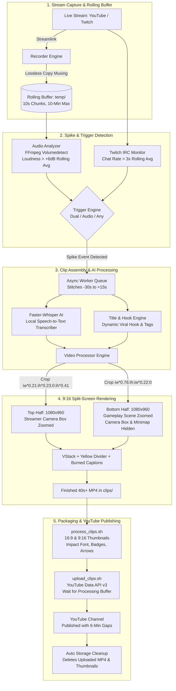

# 🎬 Anti-Clips: Autonomous AI Live Stream Clipper & YouTube Publisher

> **An end-to-end autonomous clipping engine that monitors live streams (YouTube & Twitch), detects viral hype/shouting moments, cuts 40s+ clips, edits them into high-engagement split-screen 9:16 vertical shorts, designs high-CTR viral thumbnails, and publishes them to YouTube with staggered publication gaps and automatic disk cleanup.**

---

## 📑 Table of Contents
- [Architecture & Dataflow](#-architecture--dataflow)
- [Key Features](#-key-features)
- [Quick Start](#-quick-start)
- [Complete Command Reference](#-complete-command-reference)
  - [1. Live Stream Recording & Auto-Clipping (`./record_stream.sh`)](#1-live-stream-recording--auto-clipping-record_streamsh)
  - [2. Manual On-Demand Clipping (`./manual_clip.sh`)](#2-manual-on-demand-clipping-manual_clipsh)
  - [3. Viral Thumbnail & SEO Processing (`./process_clips.sh`)](#3-viral-thumbnail--seo-processing-process_clipssh)
  - [4. YouTube Staggered Upload & Cleanup (`./upload_clips.sh`)](#4-youtube-staggered-upload--cleanup-upload_clipssh)
  - [5. Clean Code Export for Other Desktops (`./export_clean_bundle.sh`)](#5-clean-code-export-for-other-desktops-export_clean_bundlesh)
- [Split-Screen Editing Layout](#-split-screen-editing-layout)
- [YouTube Credentials Setup](#-youtube-credentials-setup)
- [Testing & Quality Assurance](#-testing--quality-assurance)
- [Future Roadmap & Extensibility](#-future-roadmap--extensibility)

---

## 🏛️ Architecture & Dataflow



---

## ✨ Key Features

1. **Dual Platform Support**:
   - Records directly from YouTube live stream URLs (`https://youtube.com/live/VIDEO_ID`) and Twitch channels (`ishowspeed`, etc.).
2. **Autonomous Trigger Engine**:
   - Continuously computes 5-minute rolling averages for audio loudness (via FFmpeg `volumedetect`) and Twitch chat velocity.
   - Fires automatically when excitement thresholds are crossed (e.g. scream/laugh or chat explosion), with a 120s cooldown guard.
3. **Optimized Vertical Split Layout (9:16 - 1080x1920)**:
   - **Top Half (1080x960)**: Isolates and zooms the streamer's webcam box (e.g., IShowSpeed's mid-left camera) to fill the entire upper half.
   - **Bottom Half (1080x960)**: Takes the gameplay screen, offset and zoomed to **completely hide the streamer's webcam box and minimap**, preventing duplicate streamer heads or clutter.
   - Features a 4px high-contrast yellow divider line.
4. **On-Demand Manual Clipper**:
   - Can stitch recent rolling buffer chunks at any time into a 40s+ vertical short without waiting for automatic triggers.
5. **Viral Thumbnail & SEO Generator**:
   - Generates both 16:9 (1280x720) and 9:16 (1080x1920) thumbnails with bold Impact fonts, 4px contrast outlines, drop shadows, reaction badge stickers, and focus arrows.
   - Auto-extracts tags, hashtags, and keyword-rich descriptions for maximum YouTube Shorts SEO.
6. **Smart YouTube Uploader**:
   - Authenticates via Google OAuth 2.0 with automatic token refresh.
   - Implements a transcode wait buffer to ensure YouTube finishes processing before attaching custom thumbnails.
   - Staggers clip uploads by **6 minutes** (`publishAt`) to avoid spam flags and maximize algorithm distribution.
   - Automatically purges uploaded `.mp4`, `.txt`, and `.jpg` files from disk after confirmation to keep disk space lean.

---

## 🚀 Quick Start

### 1. Prerequisites
Ensure **Python 3.11+**, **FFmpeg**, and **Git** are installed:
```bash
# macOS
brew install python@3.11 ffmpeg git

# Ubuntu/Debian
sudo apt update && sudo apt install -y python3.11 python3.11-venv ffmpeg git
```

### 2. Setup Virtual Environment
```bash
# Create virtual environment inside live-clipper
python3.11 -m venv live-clipper/.venv

# Install required dependencies
./live-clipper/.venv/bin/pip install --upgrade pip
./live-clipper/.venv/bin/pip install -r live-clipper/requirements.txt
```

### 3. Verify Installation
Run the 18-test unit and synthetic integration test suite (this also auto-downloads the Whisper model on first run):
```bash
./start_test.sh
```
*Expected result:* `Ran 18 tests in ~30s — OK`.

---

## 💻 Complete Command Reference

### 1. Live Stream Recording & Auto-Clipping (`./record_stream.sh`)

Continuously captures the stream, monitors audio/chat spikes, and writes 40s+ clips into `clips/`.

```bash
# Record YouTube live stream:
./record_stream.sh --url "https://www.youtube.com/live/VIDEO_ID" --facecam speed

# Record Twitch stream:
./record_stream.sh --channel ishowspeed --facecam speed

# Trigger modes and custom sensitivity:
./record_stream.sh --url "..." --trigger-mode audio --audio-spike 5.0

# Automatically stop after creating 3 clips:
./record_stream.sh --url "..." --max-clips 3
```

**Key Options:**
- `--url <URL>`: Direct YouTube stream link or Twitch link.
- `--channel <NAME>`: Channel name (default: `ishowspeed`).
- `--facecam <POS>`: Streamer facecam location (`speed`, `mid-left`, `top-right`, `bottom-right`, `top-left`, `bottom-left`, `center`, `auto`).
- `--trigger-mode <MODE>`: `dual` (chat + audio), `audio` (audio spike only), `chat` (chat rate only), or `any`.
- `--audio-spike <DB>`: dB rise over rolling baseline to trigger a clip (default: `6.0`).
- `--max-clips <N>`: Auto-stop after generating N clips.

---

### 2. Manual On-Demand Clipping (`./manual_clip.sh`)

If you are running the stream and see a viral moment happen, you can instantly cut a 40s+ clip from the recent buffer in `temp/` without waiting for the trigger engine:

```bash
# Create a 45-second clip from the last 5 chunks:
./manual_clip.sh --last 5 --duration 45 --facecam speed

# Cut a clip with a custom title:
./manual_clip.sh --last 5 --duration 45 --title "SPEED RAGES AT GTA COP" --facecam speed

# Stitch specific chunk files:
./manual_clip.sh --chunks chunk_1700000000.mp4 chunk_1700000010.mp4 chunk_1700000020.mp4
```

---

### 3. Viral Thumbnail & SEO Processing (`./process_clips.sh`)

Scans `live-clipper/clips/` for newly created clips, draws high-contrast viral thumbnails, and prepares SEO metadata for YouTube:

```bash
./process_clips.sh
```

**What it generates:**
- `*_thumb_16x9.jpg`: 1280x720 thumbnail with highlighted face frame, bold stroke title, and badge.
- `*_thumb_9x16.jpg`: 1080x1920 vertical thumbnail formatted for YouTube Shorts / Reels.
- `upload_metadata.json`: YouTube-ready title, SEO description, and search tags.

---

### 4. YouTube Staggered Upload & Cleanup (`./upload_clips.sh`)

Uploads all processed clips in `clips/` to your authenticated YouTube channel:

```bash
./upload_clips.sh
```

**Upload Behavior:**
1. Uploads video file via YouTube Data API v3 (`videos().insert`).
2. Waits 35–45 seconds for YouTube's initial transcode ingestion.
3. Attaches the generated custom thumbnail (`thumbnails().set`).
4. Staggers each video publication by **6 minutes** using `publishAt`.
5. **Automatically deletes** the local `.mp4`, companion `.txt`, and thumbnails once successfully uploaded.

---

### 5. Clean Code Export for Other Desktops (`./export_clean_bundle.sh`)

Exports a lightweight, ready-to-share source archive (`Anti-Clips-Source.zip`, ~78 KB):

```bash
./export_clean_bundle.sh
```
Automatically excludes `client_secret.json`, `youtube_token.json`, `.venv/`, models, and cached video chunks so it can be safely transferred to any computer.

---

## 📐 Split-Screen Editing Layout

The vertical video format is optimized specifically for gaming live streams:

| Screen Section | Dimensions | Content & Cropping |
| :--- | :--- | :--- |
| **Top Half** | `1080x960` | Streamer webcam box (`crop=iw*0.21:ih*0.23:0:ih*0.41`) scaled and centered to give the streamer full screen presence. |
| **Divider** | `1080x4` | Neon yellow accent line (`drawbox=y=958:h=4:color=yellow@0.95`). |
| **Bottom Half** | `1080x960` | Gameplay scene (`crop=iw*0.76:ih:iw*0.22:0`) offset to the right, **completely eliminating the streamer camera box and minimap** from the gameplay view. |

---

## 🔑 YouTube Credentials Setup

To connect your YouTube channel:

1. Obtain OAuth 2.0 Client credentials from [Google Cloud Console](https://console.cloud.google.com/):
   - Enable **YouTube Data API v3**.
   - Create an **OAuth Client ID** for *Desktop App*.
   - Save the downloaded JSON file as `client_secret.json` in the project root.
2. Run `./upload_clips.sh`:
   - A browser window will open for one-time channel authorization.
   - It saves your refresh token to `youtube_token.json`.
   - All subsequent uploads run 100% autonomously in the background.

---

## 🧪 Testing & Quality Assurance

Anti-Clips includes a comprehensive test suite covering buffer management, IRC parsing, audio spike detection, split-screen video rendering, Whisper transcriptions, and end-to-end synthetic clipping:

```bash
./start_test.sh
```

---

## 🔮 Future Roadmap & Extensibility

Here are high-impact enhancements planned for future versions:

### 1. Multi-Platform Auto-Distribution
- [ ] Direct API posting to **TikTok** (Content Posting API).
- [ ] Direct publishing to **Instagram Reels** via Instagram Graph API.
- [ ] Auto-tweeting clip previews to **X (Twitter)** with custom captions.

### 2. AI Motion & Dynamic Face Tracking
- [ ] Integrate OpenCV / MediaPipe face tracking to follow the streamer dynamically if they lean or move around in their chair.
- [ ] Smart autofocus that keeps high-intensity streamer reactions centered even in wide camera angles.

### 3. Hormozi-Style Animated Kinetic Subtitles
- [ ] Dynamic word-by-word bouncy subtitles with active word highlighting (yellow/green on black stroke).
- [ ] Sound effect insertion (vine boom, ding, whoosh) on high-energy speech moments.

### 4. LLM Smart Commentary & Clip Scoring (Gemini 2.5 Flash)
- [ ] Automatic viral potential scoring (0–100) before rendering to discard low-quality clips.
- [ ] AI-generated humorous commentary, emoji hooks, and pinned first-comment suggestions.

### 5. Instant Notifications (Discord / Telegram)
- [ ] Webhook alerts to a private Discord channel whenever a new clip is created or successfully uploaded to YouTube, complete with clip preview and analytics link.

### 6. Cloud & Headless 24/7 Deployment
- [ ] Docker container setup for 24/7 continuous stream monitoring on headless cloud servers (AWS EC2 / DigitalOcean).
- [ ] Multi-streamer monitoring dashboard capable of watching 3+ live channels simultaneously.

